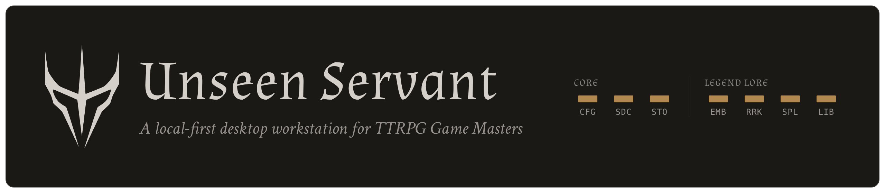
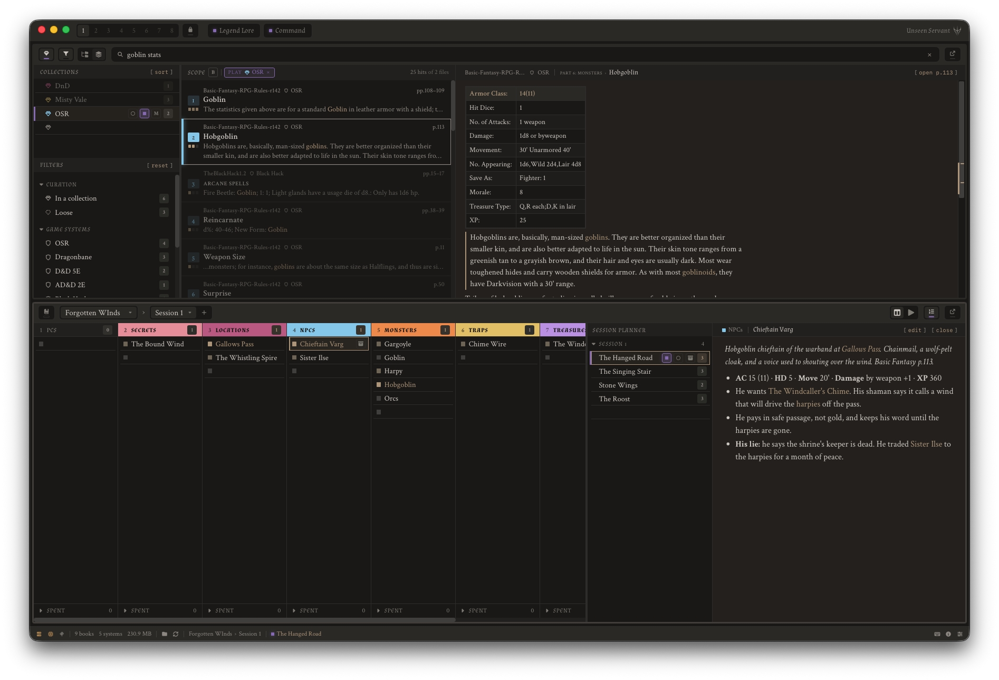
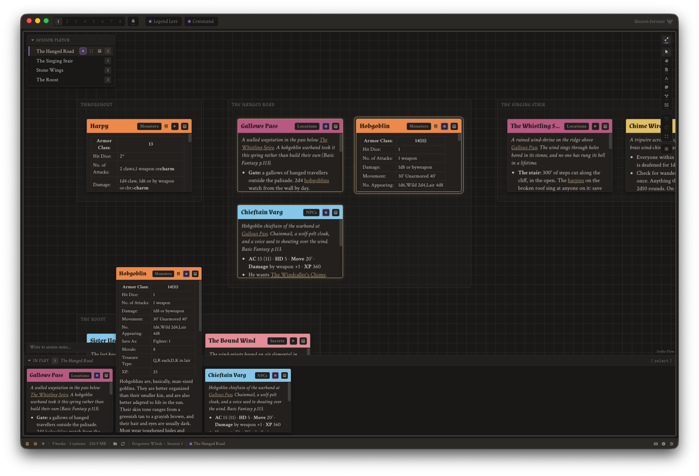

> Unseen Servant reimagines the VTT experience for live play at the table and
> invites GMs to embrace improvisation with flexible session prep.



Search every rulebook you own, prep your sessions as scenes, and run
them at the table, all from one interface. Your PDFs never leave your machine, and
your campaigns are plain Markdown files that stay yours.

**Download for macOS and Windows at [unseenservant.games](https://unseenservant.games)**.

---

## A GM workstation's rack and tools

### Legend Lore: search your PDF library

- Point it at the folder of PDFs you already have and tick the books to index.
- Ask questions in plain words ("how does grappling work") and land on the passage, with
  its book and page.
- Resolve misspells: "owlber" finds the owlbear, corrected against your own
  library's words.
- Narrow a search to a game system or a collection of books, and send the
  passage to Command as a new campaign note.

### Command: prep and run your sessions

- A campaign is a folder of notes sorted into tracks: PCs, Secrets, Locations,
  NPCs, Monsters, Traps and Treasures to start, which can be completely changed
  based on your preferences.
- Gather notes into story beats and plan a session from them. Adjust those
  scenes on the fly as the story evolves with your players.
- At the table, Command's Play lays the session's notes out as cards on a board.
  Annotate images and connect notes to the story arc as it unfolds.
- Easily add comments to the session notes during play.



### Servant: bring your own AI agent (optional)

Connect any AI agent to Unseen Servant's MCP and it can search
your library and read and write your campaigns: look up a rule, see what's in
play, file a new NPC. **Help → Guides → Servant** copies the MCP config. We
suggest using local models so that what its tools return stays on your machine.

---

## Your files stay yours

- **Local-first.** Indexing and search run on your machine, with models that
  come with the app. Nothing is downloaded after you install it.
- **No lock-in.** Campaigns are Markdown files and session boards are
  [JSON Canvas](https://jsoncanvas.org), so [Obsidian](https://obsidian.md)
  opens the same folder. Stop using Unseen Servant and everything is still
  there and readable.

---

## Get started

You need macOS on Apple Silicon or 64-bit Windows 10/11, and about 1.4 GB of
disk: the search model comes with the app.

1. **Install Unseen Servant** from [unseenservant.games](https://unseenservant.games)
   or [GitHub Releases](https://github.com/Unseen-Servant/unseen-servant-app/releases).
   - **macOS:** open the `.dmg` and drag Unseen Servant to Applications.
   - **Windows:** run the `.exe` installer. The installer isn't code-signed
     yet, so SmartScreen may say "Windows protected your PC": choose
     **More info → Run anyway**.
2. **Open Unseen Servant**, choose the folder that holds your PDFs, tick the
   books to index, and sync.
3. **Search.** **Help → Guides** walks through each tool, and the full manual
   is on [unseenservant.games](https://unseenservant.games).

---

## Build from source

Development happens on a Mac. CI runs the tests on Linux, and
[release.yml](.github/workflows/release.yml) builds the macOS and Windows
installers.

You need:

- [Rust](https://www.rust-lang.org/tools/install) (stable) and
  [Node.js](https://nodejs.org) 22.12 or later
- [uv](https://docs.astral.sh/uv/), which installs Python 3.12 for the sidecar
- [CMake](https://cmake.org) (`brew install cmake`), to build llama-server
- Xcode Command Line Tools (`xcode-select --install`)

The [Tauri prerequisites](https://tauri.app/start/prerequisites/) have the
details. Then:

```bash
git clone https://github.com/Unseen-Servant/unseen-servant-app.git
cd unseen-servant-app
npm ci
(cd sidecar && uv sync)
bash scripts/build-llama-server.sh   # compiles the pinned llama.cpp server
node scripts/fetch-models.mjs        # 1.2 GB of models, checked by sha256
npm run tauri dev
```

- Use `npm run tauri dev` to launch a dev build.
- In dev the sidecar runs from `sidecar/.venv`. Its first start compiles
  bytecode and can outlast the app's wait, so an "Indexer failed to start" on
  the very first launch only needs a relaunch.
- A dev build shares the installed app's data folder (the library index and
  settings). Make sure to run one at a time.

### How it fits together

```text
Svelte interface ⇄ Rust (Tauri) ⇄ Python sidecar (FastAPI on 127.0.0.1)
                                    ├─ llama-server + bge-m3: embeddings
                                    ├─ ONNX Runtime + MiniLM: reranking
                                    ├─ SQLite + sqlite-vec: the library index
                                    └─ campaign folders: Markdown + JSON Canvas
AI agent ⇄ MCP server (stdio) ⇄ Python sidecar
```

- `src/`: the interface, one folder per tool under `src/lib/` (`legend-lore/`,
  `command/`, `servant/`) plus the shared `shell/` and `ui/`. Its copy is in
  `messages/en.json`.
- `src-tauri/`: the native app, which starts the sidecar and relays the
  interface's calls to it.
- `sidecar/`: indexing and search (`legend_lore/`), campaign files
  (`command/`), and `mcp_server.py`, which an AI agent launches and which finds
  the running sidecar through `sidecar.port` in the app's data folder.
- `scripts/`: the builds of the sidecar, llama-server and `models/`.
- `evals/`: the retrieval eval harness. Its corpus is not in the repo
  ([evals/README.md](evals/README.md)).
- `docs/`: design records for the larger features.

[AGENTS.md](AGENTS.md) holds the project's conventions: design rules, CI
policy and the release-notes voice.

### Checks

CI runs these on Linux for the parts a change touches:

```bash
npm run check && npm run lint:css && npm test                       # interface
(cd src-tauri && cargo fmt --all -- --check \
  && cargo clippy --all-targets -- -D warnings && cargo test --lib)  # Rust
(cd sidecar && uv run pytest)                                       # sidecar
uv run --project sidecar pytest evals/tests                         # eval harness
```

### Build an installer

After the steps above, on a Mac:

```bash
bash scripts/build-sidecar.sh   # bundles the sidecar with PyInstaller
npm run tauri build
```

The `.dmg` lands in `src-tauri/target/release/bundle/dmg/`. `tauri build` stops
if a sidecar source file is newer than its bundled binary, so rerun
`build-sidecar.sh` after any sidecar change.

For Windows, follow the `build-windows` job in release.yml: it builds
llama-server with the Vulkan SDK and runs the same PyInstaller steps in
PowerShell.

---

## Reporting bugs

[CHANGELOG.md](CHANGELOG.md) lists what each release changed. I'm not taking
code contributions yet unfortunately. However, bug reports are welcome: open an
issue with the bug report template. For search or indexing problems, attach
`sidecar.log` (log folder **found** next to the data directory in **Help → About**).

Email <guild@unseenservant.games> if you want to share feedback on the app!

---

## Credits

Unseen Servant is inspired by the following awesome products:

- **[Ableton Live](https://www.ableton.com/live/)**: Command's tracks, beats and
  sessions, and campaigns that open like Live sets.
- **[Obsidian](https://obsidian.md)** and **[JSON Canvas](https://jsoncanvas.org)**:
  a campaign is a folder of plain files that other tools open too.
- **The Lazy DM checklist** from [Sly Flourish](https://slyflourish.com)'s
  _Return of the Lazy Dungeon Master_, by Mike Shea: Command's default tracks
  follow it.

It is built on [Tauri](https://tauri.app), [Svelte](https://svelte.dev),
[CodeMirror](https://codemirror.net), [Svelte Flow](https://svelteflow.dev),
[PyMuPDF](https://pymupdf.readthedocs.io), [llama.cpp](https://github.com/ggml-org/llama.cpp) with
[BGE-M3](https://huggingface.co/BAAI/bge-m3),
[fastembed](https://github.com/qdrant/fastembed) and
[ONNX Runtime](https://onnxruntime.ai) with an MS MARCO MiniLM cross-encoder,
[SymSpell](https://github.com/wolfgarbe/SymSpell),
[sqlite-vec](https://github.com/asg017/sqlite-vec),
[Font Awesome](https://fontawesome.com), and the Crimson Text and Almendra
typefaces. [ACKNOWLEDGEMENTS.txt](ACKNOWLEDGEMENTS.txt) lists every component
with its licence, and ships in the app under **Help → About**.

Unseen Servant is not affiliated with or endorsed by any project or product
named here.

---

## License

Copyright © 2026 Jerome Solis, doing business as Unseen Servant Games.

Unseen Servant is free software: you can redistribute it and/or modify it under
the terms of the GNU Affero General Public License as published by the Free
Software Foundation, either version 3 of the License, or (at your option) any
later version. See [LICENSE](LICENSE).

The AGPL covers the code, not the Unseen Servant name or logo: they are
trademarks of Unseen Servant Games (AGPL §7(e)), so a fork must use its own
name and logo.
